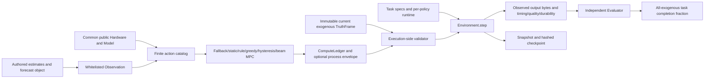
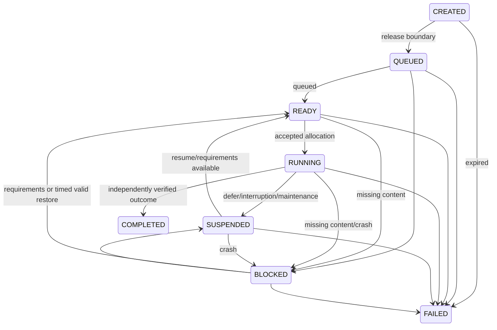

# Implemented model and architecture — p5-synthetic-0.1

## Architecture



TruthFrame is immutable and never passed to controllers. Estimates are separately authored or later supplied by an approved estimator. The engineering runner derives the policy's own task/battery/previous-action state; this is locally visible causal state, not latent network truth. Future realized frames are absent from controller requests. Shared exogenous inputs and definitions do not imply identical policy queues after different actions.

## Data flow

```mermaid
sequenceDiagram
  participant Runner as Engineering runner
  participant Controller as Estimate-only controller
  participant Validator as True execution validator
  participant Model as Environment
  participant Oracle as Byte-outcome evaluator
  Runner->>Controller: Current estimates, forecasts, public hardware/costs
  Controller->>Controller: Build estimated catalog; charged prediction calls
  Controller-->>Runner: Action, status, reads, evaluations, timings, hashes
  Runner->>Validator: Current TruthFrame + proposed Action + causal battery
  Validator-->>Model: Accept or reject/defer using common constraints
  Model->>Model: Stall, transfer, compute, queue, energy, deadlines
  Model->>Oracle: Observed bytes, finish time, quality, age, durability
  Oracle-->>Runner: All-scheduled denominator fraction; failures retained
  Runner->>Runner: Atomic state/result files and source/output hashes
```

## Lifecycle



The exact allow-list is tasks.TRANSITIONS. Terminal states have no outgoing transition. Arrival schedules belong to fixed task specs; CREATED tasks are not available before released_s. A caller must split a frame at an interior release boundary; the model rejects unsplit arrivals instead of pretending they received whole-slot service. Endpoint denominator includes all configured exogenous eligible tasks, including missing, rejected and not-yet-released outcomes over an improperly truncated horizon. A proper future horizon must cover its prespecified releases/deadlines.

TaskSpec declares baseline work Mcycles, memory MB, input Mbit, local eligibility/network dependence, operation, ordered required content keys, release/deadline, max age, minimum quality, durable completion and checkpoint eligibility. UTF-8 copy/reverse/upper are implemented constructed workloads. Server-only/unknown operations fail. Required content supplies the actual input bytes; wrong bytes fail the independent expected SHA256. References are supplied separately in task specs, never policy scores. Content version is represented by bytes/hash and generated timestamp, not user usefulness. No real WAIKE lessons, learners, network server or production execution is implied.

## Resource and queue equations

Duration Δ in seconds; capacity Mbps=Mbit/s; CPU Mcycles/s; memory decimal MB; power W=J/s; battery J. For allocated task i, time available before its deadline is D_i=max(0,min(Δ,deadline_i-now)-switch_stall). Latency is paid before transfer; previously paid latency persists on the same path and resets on path/migration change. D_i then pays remaining input/rate seconds. Transfer=min(remaining Mbit,b_i D_i). Remaining CPU service=min(remaining Mcycles,c_i remaining time). Parallel tasks have disjoint allocations whose sums obey current path capacity, terminal bandwidth/CPU/memory/power and placement CPU. Local actions allocate zero bandwidth and cannot execute network-required, nonlocal or uncached-input tasks. Every proposal is validated before any service or energy debit.

Deadline success uses exact within-frame finish time, not merely slot end. At the end, unfinished released tasks whose deadline has been reached fail. COMPLETED requires correct hash, required quality, age and durability. Unsupported/wrong/stale outputs are recorded as failures; attempted wrong bytes remain in snapshot.attempts. Missing content blocks until available/deadline. Reject/defer suspends a running task and preserves volatile progress on unchanged placement. Migration discards volatile progress and transfers latency/input again; durable restoration is explicit and timed. Model change and workload identity are checked on restart.

Queue length is the count of released nonterminal tasks. Admission to the allocation catalog depends on memory; tasks not selected remain in the same endpoint denominator. There is no infinite-resource service, negative queue, duplicate completion or terminal execution. Scheduling within a slot is fluid and static, not a packet-level simulator; no mid-slot reallocation of newly freed resources. Profile priority is demand/deadline weighting, not proven fair scheduling. Degraded fidelity currently lowers observed quality only and does not reduce work; it has no demonstrated benefit and is deliberately not supplied a favorable invented speedup. A justified fidelity/cost model remains a scientific decision.

## Energy and switching

E_next=E_current−(sum allocated power_w × Δ + transition_energy_j) for accepted execution. Full-interval reserved power is charged even when a task finishes early: this is a conservative synthetic convention, not measured power dynamics. A rejected/deferred action has zero modeled service/cost. Background idle, radio protocol/device battery nonlinearities and unmodeled hardware are absent; no claim that they consume zero in reality. No recharge model is enabled. Action/resource checks are exact without a numerical over-budget tolerance. Allocation shares project floating residuals down to capacity; ledger sum equality alone uses 1e−12 floating comparison, never to admit overshoot.

Network and placement changes add their respective stall/energy; the first executed action is uncharged. Defer does not erase previous executed placement. Switching stall ≥ Δ rejects that interval; no partial multi-interval switch is invented. Future study must decide whether to implement queued multi-interval handover. Both primary policies use exactly the same Model object/hash and execution function. Costs are assumed, not field measurements.

Checkpoint/restore require positive elapsed duration and affordable explicit energy, suspend other running work and advance global virtual time/deadlines. A checkpoint stores task ID/spec hash, progress/input, placement/path, creation time and digest. Crash removes volatile progress; restore needs valid matching checkpoint and takes specified positive time. Latency must be repaid after restore. Durability is synthetic retained model state, not an operating-system fsync/flash claim. Failed restore/deadline/energy checks are retained, not silent success. Checkpoint API is implemented separately from the P4 primary action families; no adaptive checkpoint policy or campaign is claimed.

## Correlation and calibration boundaries

A single immutable current-frame tuple can jointly gate TN/NTN gateway/terminal/visibility and placement/resource limits. Constructed common-gateway outage is tested. No prospective stochastic Markov/Poisson/common-cause generator, calibrated forecast, orbital/RF model or reserved random stream is executed. Authorized future distribution/estimator implementation belongs to the scientifically frozen next milestone. Paper III architectural graph and independent backup power remain separate future study work. This package can consume such later frame sequences without rewriting historical results.
